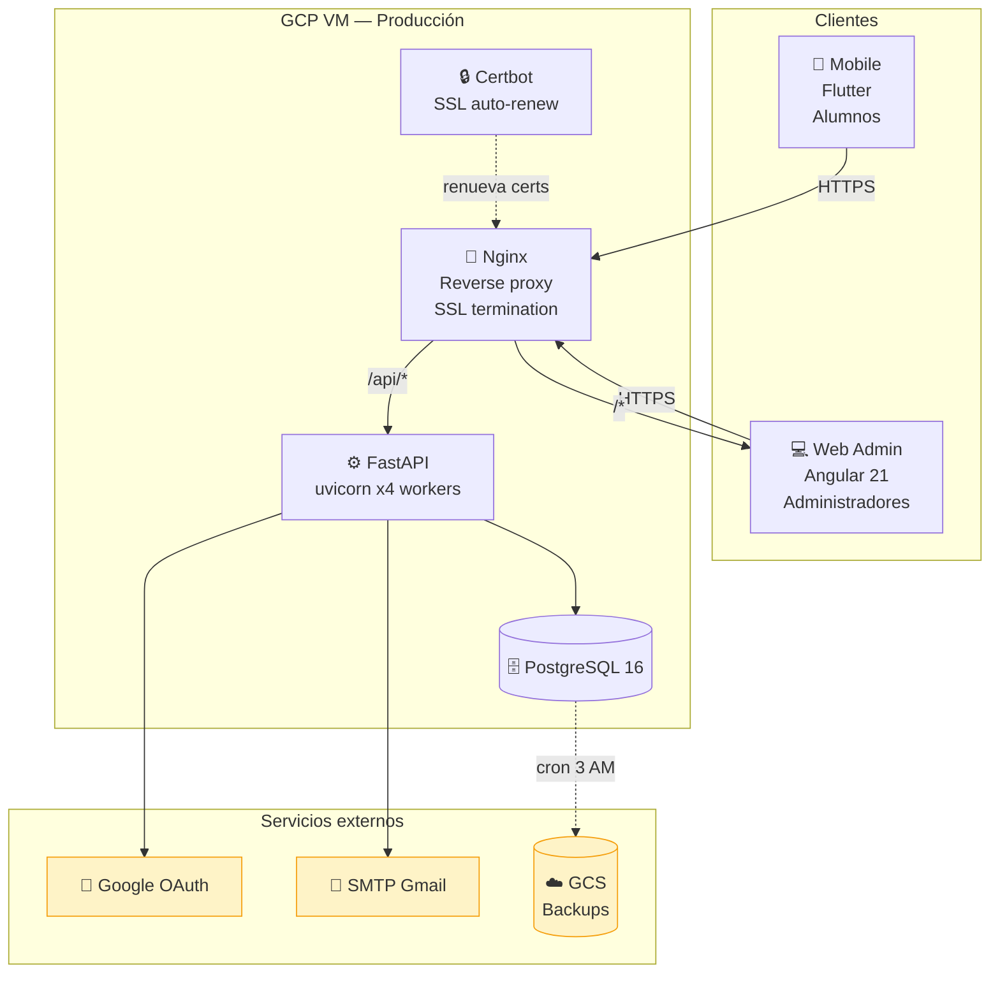
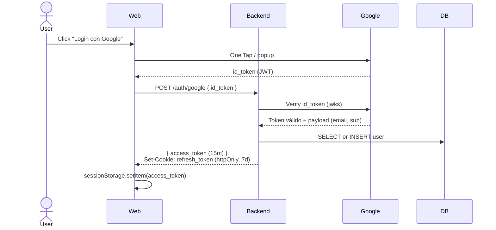
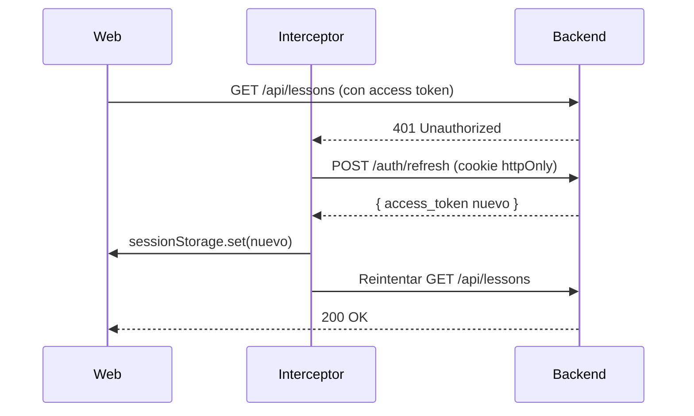
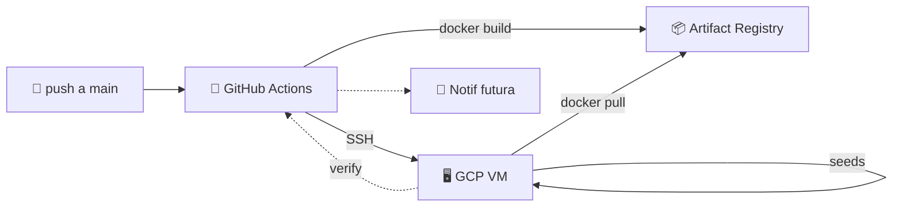

# Arquitectura — PianoVision AI

Este documento describe la arquitectura de PianoVision AI: componentes, flujos de datos, despliegue y decisiones de diseño.

## Vista general

PianoVision es una plataforma de aprendizaje de piano con tres clientes y un backend unificado.



## Componentes

### Backend — FastAPI

| Aspecto | Decisión | Por qué |
|---|---|---|
| Framework | **FastAPI** | Async nativo, type hints, OpenAPI auto-generado |
| ORM | **SQLAlchemy 2 async** | Estándar Python maduro, soporte async |
| Migraciones | **Alembic** | Estándar de SQLAlchemy, version-controlled schema |
| Validación | **Pydantic v2** | Integración directa con FastAPI |
| Auth | **JWT** (access) + **httpOnly cookie** (refresh) + **Google OAuth** | Access short-lived (15 min) en memoria, refresh largo (7 días) en cookie segura |
| Workers | **uvicorn x4** | 1 worker por core de la VM |

**Estructura interna:**

```
backend/app/
├── api/              # routers (FastAPI APIRouter por dominio)
├── core/             # config, security, dependencies
├── crud/             # operaciones de DB (separadas de la lógica HTTP)
├── models/           # SQLAlchemy ORM models
├── schemas/          # Pydantic schemas (request/response)
├── services/         # lógica de dominio (email, achievements, etc.)
└── main.py           # FastAPI app factory
```

> **Patrón:** capa fina de routers que delega a `services/` o `crud/`. Los routers no contienen lógica de negocio.

### Web — Angular 21

| Aspecto | Decisión | Por qué |
|---|---|---|
| Framework | **Angular 21** | Standalone components, signals, zoneless |
| State | **Signals** (sin NgRx) | Suficiente para un admin panel; menos boilerplate |
| HTTP | **HttpClient + interceptors** | Auth + refresh token automático en interceptor |
| UI | **Angular Material + Lucide** | Material accesible + iconos modernos |
| Auth storage | **sessionStorage** (access token) + **cookie httpOnly** (refresh) | Refresh no accesible desde JS = inmune a XSS |

**Estructura:**

```
web/src/app/
├── core/                 # singletons (servicios, interceptors, guards)
├── features/             # módulos por dominio (lazy-loaded)
│   ├── lessons/
│   ├── users/
│   ├── moderation/
│   └── rankings/
└── shared/               # componentes/pipes/directivas reutilizables
```

### Mobile — Flutter

| Aspecto | Decisión |
|---|---|
| State | **BLoC pattern** (flutter_bloc) |
| HTTP | **Dio** con interceptor de auth |
| Routing | **GoRouter** |
| Local storage | **flutter_secure_storage** para tokens |

**Conectividad al backend:** automática según plataforma — ver [mobile/lib/core/config/app_config.dart](../mobile/lib/core/config/app_config.dart):
- iOS / Web / Desktop → `http://localhost:8000`
- Android → `http://10.0.2.2:8000` (gateway del emulador hacia el host)

### Infraestructura — Nginx + Postgres + Certbot

Ver [infra/docker-compose.yml](../infra/docker-compose.yml). Todo corre como containers en una sola VM:

| Container | Imagen | Puerto host | Notas |
|---|---|---|---|
| `db` | postgres:16-alpine | 127.0.0.1:5432 | Volume persistente, healthcheck |
| `backend` | Build local | 127.0.0.1:8000 | 4 workers uvicorn |
| `web` | Build local | 127.0.0.1:4000 | nginx interno sirve los estáticos |
| `nginx` | nginx:alpine | 80, 443 | Único expuesto al mundo |
| `certbot` | certbot/certbot | — | Run on demand para renovar SSL |

> Solo Nginx escucha en interfaces públicas. Backend y web binds a `127.0.0.1` — invisibles desde fuera de la VM.

## Flujos importantes

### Login con Google OAuth



### Refresh automático del access token



### Despliegue continuo



Pasos del job [deploy.yml](../.github/workflows/deploy.yml):

1. **Build & push** — Docker build de `backend/` y `web/`, push a Artifact Registry (`:${SHA}` y `:latest`).
2. **Copy infra files** — `infra/docker-compose.yml` + `infra/nginx/` a la VM por SSH.
3. **Deploy** — `docker compose pull` + `up -d` en la VM.
4. **Migraciones** — `alembic upgrade head`.
5. **Seeds idempotentes** — los 3 `seed_*.py`.
6. **Verify** — curl al `/docs` del backend.

## Decisiones de diseño relevantes

### ¿Por qué monorepo y no repos separados?

- **Cambios atómicos** — un breaking change en el schema del backend se commitea junto con su consumidor (web/mobile).
- **CI simple** — un solo pipeline.
- **Onboarding** — un solo clone.
- **Costo**: requiere disciplina con `.gitignore` y `.dockerignore` para que cada build solo lleve lo suyo.

### ¿Por qué VM y no Cloud Run / GKE?

- **Costo** — una VM e2-small (~$15/mes) sirve hasta ~10k MAU. Cloud Run cuesta más en proyectos con tráfico constante.
- **Simplicidad operacional** — `docker compose` es trivial. K8s es complejo y caro.
- **Ollama futuro** — el `infra/docker-compose.yml` ya tiene un servicio Ollama listo para IA local; eso necesita GPU + VM.
- **Cuándo migrar**: cuando un solo host sea un punto único de falla intolerable.

### ¿Por qué seeds idempotentes en cada deploy?

- **Self-healing** — si alguien borra un logro manualmente, se recrea en el próximo deploy.
- **Devs nuevos** — clonan, deployan, tienen data lista para probar.
- **Riesgo**: si un seed se corrompe, corrompe en cada deploy. Mitigación: los seeds chequean existencia antes de insertar.

### Patrón de auth (JWT + httpOnly cookie)

- **Access token (JWT, 15 min)** en `sessionStorage` — accesible desde JS para enviar en `Authorization: Bearer`.
- **Refresh token (largo, 7 días)** en cookie `httpOnly` `Secure` `SameSite=Strict` — invisible para JS.

| Threat | Mitigación |
|---|---|
| XSS roba el access token | El access dura 15 min y no hace daño grave; refresh no es accesible vía JS |
| CSRF en el refresh | `SameSite=Strict` evita el envío cross-site |
| Token leak en logs | Tokens nunca van en URL ni en query params |

## Roadmap arquitectónico

Mejoras planeadas, por orden de impacto:

1. **Backups offsite** — pg_dump → GCS daily (vía cron en la VM).
2. **Monitoring de uptime** — UptimeRobot / Better Stack.
3. **Logs centralizados** — Cloud Logging o Loki (hoy son `docker compose logs` via SSH).
4. **Staging environment** — VM secundaria con su propio pipeline.
5. **Métricas** — Prometheus + Grafana o GCP native metrics.
6. **CDN para web** — Cloud CDN delante de nginx para assets estáticos.
7. **Image registry GC** — política de retention en Artifact Registry (hoy crece sin límite).
8. **Read replicas de Postgres** — cuando lecturas saturen al primario.

> Nada de esto es necesario hoy. Cada uno se agrega cuando aparece su problema, no antes.
