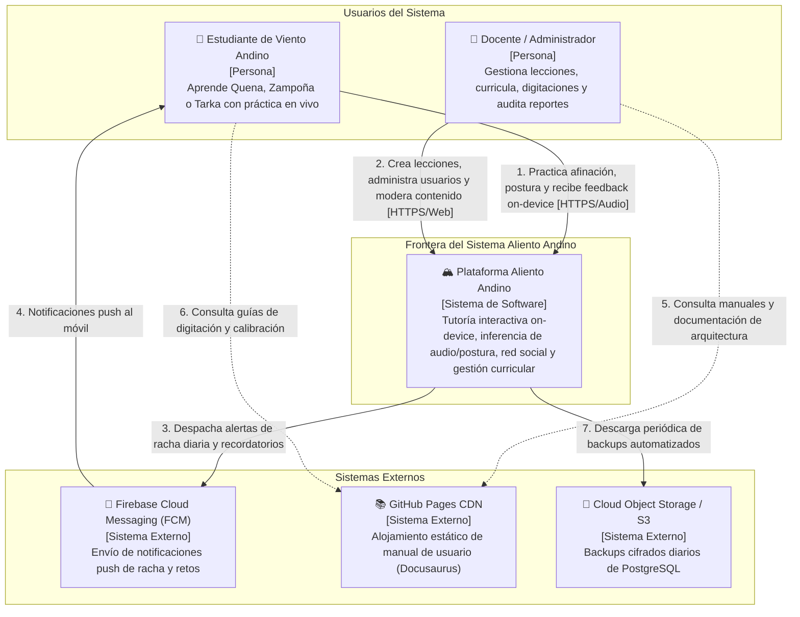
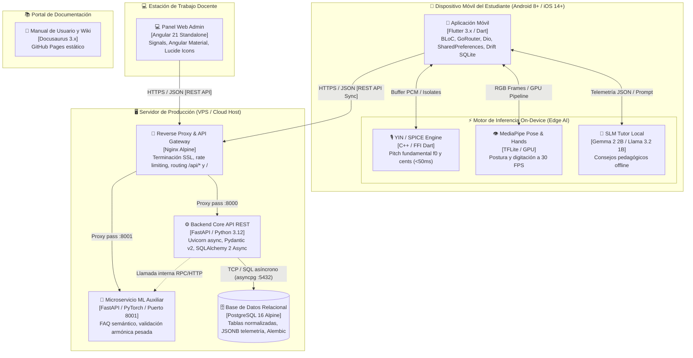
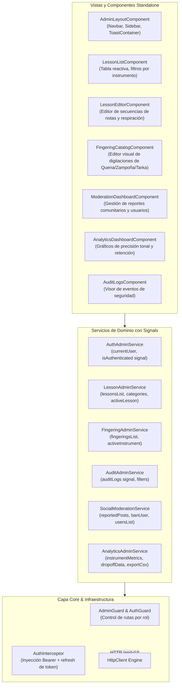
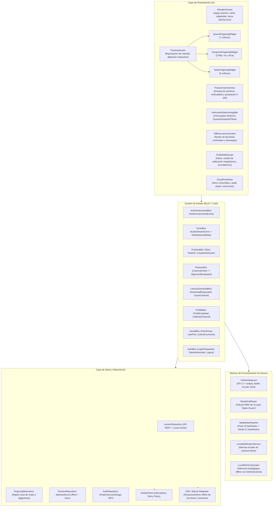
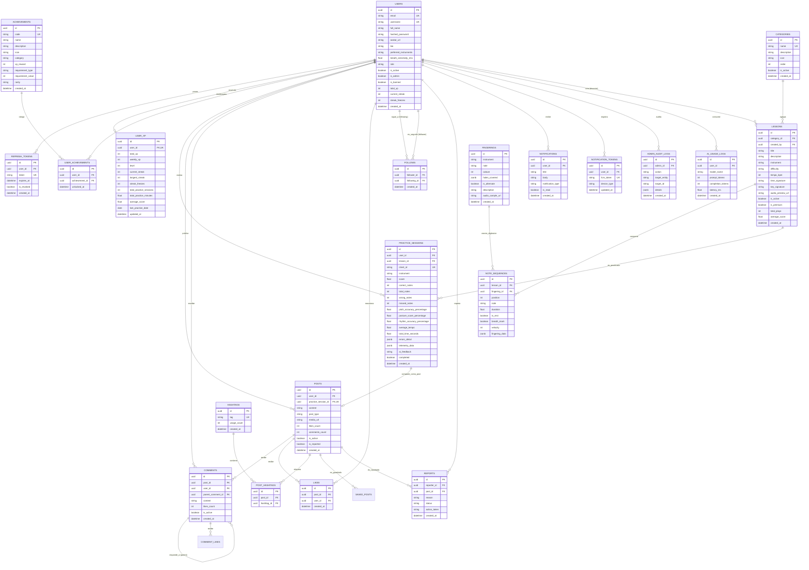
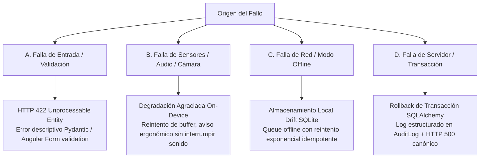
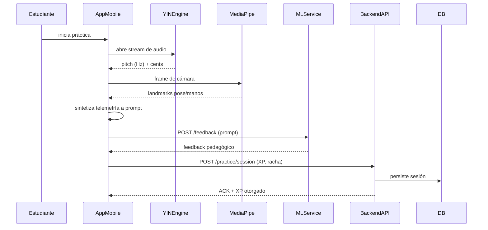

# Modelo C4 de Arquitectura de Software — Aliento Andino

> **Sistema**: Plataforma de Tutoría Virtual y Red Social para Instrumentos de Viento Andinos (Quena, Zampoña y Tarka).  
> **Estándar**: C4 Model (Context, Containers, Components, Code) por Simon Brown.  
> **Trazabilidad**: Enlazado con [`ARCHITECTURE.md`](ARCHITECTURE.md), [`SPRINTS_AND_USER_STORIES.md`](SPRINTS_AND_USER_STORIES.md), [`QUALITY_STANDARDS.md`](QUALITY_STANDARDS.md), [`CODING_STANDARDS.md`](CODING_STANDARDS.md) y tokens en [`../DESIGN.md`](../DESIGN.md).

---

## 1. Nivel 1: Diagrama de Contexto del Sistema (System Context)

El diagrama de contexto ubica a **Aliento Andino** dentro de su ecosistema operativo, delimitando a los usuarios y los sistemas externos con los que se relaciona.



### Descripción de Elementos de Contexto

| Elemento                        | Tipo                | Descripción                                                                                                                 |
| :------------------------------ | :------------------ | :-------------------------------------------------------------------------------------------------------------------------- |
| **Estudiante de Viento Andino** | Persona             | Usuario móvil que interpreta Quena, Zampoña o Tarka frente al micrófono y cámara.                                           |
| **Docente / Administrador**     | Persona             | Usuario del panel web encargado de la curaduría pedagógica y moderación comunitaria.                                        |
| **Plataforma Aliento Andino**   | Sistema de Software | Núcleo integral que procesa la telemetría, autentica usuarios, almacena progreso y brinda tutoría interactiva.              |
| **Firebase Cloud Messaging**    | Sistema Externo     | Servicio de mensajería para alertas de inactividad, preservación de racha (_Streak Flame_) y retos semanales.               |
| **GitHub Pages CDN**            | Sistema Externo     | Red de distribución de contenido que aloja el portal Docusaurus con manuales y especificaciones técnicas.                   |
| **Cloud Object Storage**        | Sistema Externo     | Repositorio de almacenamiento de objetos donde se depositan los backups comprimidos (`pg_dump`) generados por scripts cron. |

---

## 2. Nivel 2: Diagrama de Contenedores (Containers)

El diagrama de contenedores describe las aplicaciones, almacenes de datos y microservicios que componen **Aliento Andino**, indicando protocolos de comunicación y límites tecnológicos.



> **Nota:** el motor YIN se ejecuta 100 % on-device dentro de un Isolate C++/Dart en Flutter. No se envía audio a la nube en tiempo de ejecución.

### Especificación de Contenedores

| Contenedor           | Tecnología                     | Responsabilidad                                                                                             | Protocolos                      |
| :------------------- | :----------------------------- | :---------------------------------------------------------------------------------------------------------- | :------------------------------ |
| **Mobile App**       | Flutter 3.x (Dart)             | Interfaz de práctica, captura de audio/video, orquestación de feedback, sincronización offline.             | HTTPS (REST), FFI a C++         |
| **Motor On-Device**  | C++, TFLite, MediaPipe, WebLLM | Detección de pitch $<50\text{ms}$, visión a 30 FPS y generación de consejos con 0 bytes enviados a la nube. | En memoria (Pointers / JSON)    |
| **Web Admin**        | Angular 21 Standalone          | Panel administrativo para gestión curricular de notas/digitaciones, estadísticas de uso y moderación.       | HTTPS (REST/JSON)               |
| **Reverse Proxy**    | Nginx Alpine                   | Gateway perimetral, balanceador de carga local, terminación SSL, rate limiting contra abusos (DDoS).        | HTTP/1.1, HTTPS (TLS 1.3)       |
| **Backend API**      | FastAPI / Python 3.12          | Autenticación JWT rotativa, lógica de negocio de lecciones, evaluación de rachas, rankings y muro social.   | HTTPS / REST / asyncpg          |
| **Microservicio ML** | FastAPI / Python 3.12 (8001)   | Motor complementario de embeddings semánticos para FAQ musical y validaciones armónicas complejas.          | HTTP / REST                     |
| **Base de Datos**    | PostgreSQL 16 Alpine           | Persistencia de usuarios, secuencias de notas, intentos de práctica, auditoría y relaciones sociales.       | PostgreSQL Wire Protocol (5432) |
| **Docs Site**        | Docusaurus 3 (pnpm)            | Wiki técnica y manual de usuario desplegado en GitHub Pages.                                                | HTTPS estático CDN              |

---

## 3. Nivel 3: Diagramas de Componentes (Components)

### 3.1 Componentes de Backend Core API (`apps/backend`)

El backend sigue una arquitectura en capas estrictamente desacoplada: **Routers $\rightarrow$ Services $\rightarrow$ Models / Database**.

```mermaid
flowchart TD
    subgraph RoutersLayer ["Capa de Routers (HTTP / Endpoints)"]
        AuthR["AuthRouter<br/>/api/v1/auth"]
        UsersR["UsersRouter<br/>/api/v1/users"]
        LessonR["LessonsRouter<br/>/api/v1/lessons"]
        FingeringR["FingeringsRouter<br/>/api/v1/fingerings"]
        PracticeR["PracticeRouter<br/>/api/v1/practice"]
        SocialR["SocialRouter<br/>/api/v1/social"]
        RankingR["RankingsRouter<br/>/api/v1/rankings"]
        NotificationR["NotificationsRouter<br/>/api/v1/notifications"]
        AnalyticsR["AnalyticsRouter<br/>/api/v1/analytics"]
        TutorR["TutorRouter<br/>/api/v1/tutor"]
        AuditR["AuditRouter<br/>/api/v1/admin/audit"]
    end

    subgraph SecurityLayer ["Capa de Seguridad & Dependencias"]
        AuthDep["AuthDependency<br/>(get_current_user, get_current_admin)"]
        RateLimit["RateLimiter<br/>(Slowapi / TokenBucket)"]
        DBSession["DatabaseSession<br/>(get_db asyncpg)"]
    end

    subgraph SchemasLayer ["Capa de Contratos (Pydantic v2)"]
        AuthSchemas["AuthSchemas<br/>(UserRegister, UserLogin, TokenResponse)"]
        UserSchemas["UserSchemas<br/>(UserUpdate, UserProfileResponse)"]
        LessonSchemas["LessonSchemas<br/>(LessonCreate, LessonResponse, NoteSequenceCreate)"]
        FingeringSchemas["FingeringSchemas<br/>(FingeringCreate, FingeringResponse)"]
        PracticeSchemas["PracticeSchemas<br/>(PracticeSubmitRequest, PracticeSessionResponse)"]
        SocialSchemas["SocialSchemas<br/>(PostCreate, PostResponse, CommentCreate)"]
        RankingSchemas["RankingSchemas<br/>(LeaderboardResponse, StreakResponse)"]
        AnalyticsSchemas["AnalyticsSchemas<br/>(InstrumentMetricsResponse, DropoffResponse)"]
    end

    subgraph ServicesLayer ["Capa de Servicios de Negocio"]
        AuthSvc["AuthService<br/>(login, register, rotate_refresh_token)"]
        UserSvc["UserService<br/>(update_profile, update_breath_profile)"]
        LessonSvc["LessonService<br/>(get_lessons, create_lesson, get_by_id)"]
        FingeringSvc["FingeringService<br/>(create_fingering, get_by_instrument)"]
        PracticeSvc["PracticeService<br/>(submit_session, get_history, calculate_xp)"]
        SocialSvc["SocialService<br/>(create_post, get_feed, toggle_reaction)"]
        RankingSvc["RankingService<br/>(get_leaderboard, update_streaks)"]
        NotificationSvc["NotificationDispatcher<br/>(send_push, schedule_reminder)"]
        AnalyticsSvc["AnalyticsService<br/>(get_instrument_metrics, get_dropoff)"]
        TutorSvc["TutorService<br/>(generate_fallback_advice, log_ai_usage)"]
        AuditSvc["AuditService<br/>(log_admin_action, query_audit_logs)"]
    end

    subgraph ModelsLayer ["Capa de Persistencia (SQLAlchemy 2 Async)"]
        UserModel["UserModel & RefreshTokenModel (users, refresh_tokens)"]
        LessonModel["LessonModel, CategoryModel, NoteSequenceModel"]
        FingeringModel["FingeringModel (fingerings)"]
        PracticeModel["PracticeSessionModel (practice_sessions)"]
        SocialModel["PostModel, CommentModel, LikeModel, FollowModel, ReportModel"]
        RankingModel["UserXPModel, AchievementModel, UserAchievementModel"]
        NotificationModel["NotificationModel, NotificationTokenModel"]
        AnalyticsModel["AdminAuditLogModel, AiUsageLogModel, AppSettingModel"]
    end

    RoutersLayer --> SecurityLayer
    RoutersLayer --> SchemasLayer
    RoutersLayer --> ServicesLayer
    ServicesLayer --> ModelsLayer
    ModelsLayer --> DBSession
```



---

### 3.2 Componentes de la Aplicación Web Admin (`apps/web`)

Desarrollada en Angular 21 con arquitectura Standalone, Signals y control de acceso RBAC.



---

### 3.3 Componentes de la Aplicación Móvil (`apps/mobile`)

Estructurada en Flutter 3.x con Clean Architecture, BLoC reactivo e inferencia local desacoplada.



> La especialización refleja la organología andina distinta por instrumento (orificios vs tubos, embocadura, digitación).

---

## 4. Nivel 4: Diagrama Entidad-Relación y Clases Clave (Code & Data Level)

### 4.1 Diagrama Entidad-Relación Completo de la Base de Datos (PostgreSQL 16)

El siguiente diagrama formaliza la **topología relacional completa de la base de datos**, garantizando que **todas las tablas estén interconectadas** mediante claves foráneas íntegras y reglas de cascada (`ON DELETE CASCADE` o `SET NULL`):



---

### 4.2 Diagrama de Clases del Dominio de Software

```mermaid
classDiagram
    class InstrumentType {
        <<enumeration>>
        QUENA
        ZAMPONA
        TARKA
    }

    class DifficultyLevel {
        <<enumeration>>
        PRINCIPIANTE
        INTERMEDIO
        AVANZADO
    }

    class User {
        +UUID id
        +string email
        +string username
        +string full_name
        +string preferred_instruments
        +float breath_sensitivity_rms
        +string role
        +int total_xp
        +int current_streak
        +int streak_freezes
        +bool is_active
        +update_breath_profile(float rms) void
        +switch_active_instrument(InstrumentType inst) void
    }

    class Lesson {
        +UUID id
        +UUID category_id
        +string title
        +InstrumentType instrument
        +DifficultyLevel difficulty
        +int tempo_bpm
        +string time_signature
        +string key_signature
        +int total_plays
        +float average_score
        +List~NoteSequence~ notes
        +validate_notes_sequence() bool
    }

    class NoteSequence {
        +UUID id
        +UUID lesson_id
        +UUID fingering_id
        +int position
        +string note
        +float duration
        +bool is_rest
        +bool breath_mark
        +int velocity
        +Map fingering_data
    }

    class Fingering {
        +UUID id
        +InstrumentType instrument
        +string note
        +int octave
        +Map holes_covered
        +bool is_alternate
        +string audio_sample_url
        +validate_unique_primary() bool
    }

    class PracticeSession {
        +UUID id
        +UUID user_id
        +UUID lesson_id
        +string client_id
        +InstrumentType instrument
        +float score
        +float pitch_accuracy_percentage
        +float posture_score_percentage
        +float rhythm_accuracy_percentage
        +Map telemetry_data
        +string ai_feedback
        +bool completed
        +calculate_final_xp() int
    }

    class UserXP {
        +UUID id
        +UUID user_id
        +int total_xp
        +int weekly_xp
        +int level
        +int current_streak
        +int streak_freezes
        +add_xp(int xp) void
        +consume_freeze_if_needed() bool
    }

    class Post {
        +UUID id
        +UUID user_id
        +UUID practice_session_id
        +string content
        +string post_type
        +int likes_count
        +int comments_count
        +bool is_active
    }

    User "1" --o "*" PracticeSession : ejecuta
    Lesson "1" --* "*" NoteSequence : contiene
    Lesson "1" --o "*" PracticeSession : evalúa
    Fingering "1" --o "*" NoteSequence : mapea
    User "1" --|{ "1" UserXP : posee
    PracticeSession "0..1" --o "1" Post : genera
    User "1" --o "*" Post : publica
```

---

## 5. Matriz de Continuidad de Nomenclatura y Contratos Unificados

Para cumplir con la directriz de **tolerancia cero a discrepancias de nombres**, la siguiente tabla define el estándar canónico en todas las capas tecnológicas:

| Concepto de Negocio             | Campo en Base de Datos (SQL) | Schema Backend (Pydantic)                     | DTO Web Admin (TypeScript)                    | Modelo Mobile (Dart)                                |
| :------------------------------ | :--------------------------- | :-------------------------------------------- | :-------------------------------------------- | :-------------------------------------------------- |
| **Identificador Lección**       | `id` (UUID)                  | `id: UUID`                                    | `id: string`                                  | `String id`                                         |
| **Categoría Asignada**          | `category_id` (UUID)         | `category_id: UUID`                           | `category_id: string`                         | `String categoryId` (con `@JsonKey('category_id')`) |
| **Tempo en BPM**                | `tempo_bpm` (INTEGER)        | `tempo_bpm: int`                              | `tempo_bpm: number`                           | `int tempoBpm`                                      |
| **Instrumento Andino**          | `instrument` (VARCHAR)       | `instrument: str` (`quena`/`zampona`/`tarka`) | `instrument: 'quena' \| 'zampona' \| 'tarka'` | `InstrumentType instrument`                         |
| **Digitación Asociada**         | `fingering_id` (UUID)        | `fingering_id: UUID \| None`                  | `fingering_id: string \| null`                | `String? fingeringId`                               |
| **Orificios / Tubos Cubiertos** | `holes_covered` (JSONB)      | `holes_covered: dict`                         | `holes_covered: Record<string, boolean>`      | `Map<String, dynamic> holesCovered`                 |
| **Marca de Respiración**        | `breath_mark` (BOOLEAN)      | `breath_mark: bool`                           | `breath_mark: boolean`                        | `bool breathMark`                                   |
| **Desviación en Cents**         | `cents_deviation` (JSONB)    | `cents_deviation: float`                      | `cents_deviation: number`                     | `double centsDeviation`                             |
| **Sensibilidad de Soplo**       | `breath_sensitivity_rms`     | `breath_sensitivity_rms: float`               | `breath_sensitivity_rms: number`              | `double breathSensitivityRms`                       |
| **Puntuación de Postura**       | `posture_score_percentage`   | `posture_score_percentage: float`             | `posture_score_percentage: number`            | `double postureScorePercentage`                     |
| **Precisión de Tono**           | `pitch_accuracy_percentage`  | `pitch_accuracy_percentage: float`            | `pitch_accuracy_percentage: number`           | `double pitchAccuracyPercentage`                    |
| **Secuencia de Notas**          | `note_sequences` (Tabla)     | `notes: list[NoteSequenceResponse]`           | `notes: NoteSequence[]`                       | `List<NoteSequenceModel> notes`                     |
| **Idempotencia Cliente**        | `client_id` (UUID único)     | `client_id: UUID \| None`                     | N/A                                           | `String clientId`                                   |
| **Racha de Días**               | `current_streak` (INTEGER)   | `current_streak: int`                         | `current_streak: number`                      | `int currentStreak`                                 |
| **Congeladores Racha**          | `streak_freezes` (INTEGER)   | `streak_freezes: int`                         | `streak_freezes: number`                      | `int streakFreezes`                                 |

### Regla Canónica de Métodos y Endpoints por Capa

- **Catálogo de Lecciones**:
  - Endpoint: `GET /api/v1/lessons?instrument={inst}&difficulty={diff}`
  - Backend Service: `LessonService.get_lessons(db, instrument, difficulty, skip, limit)`
  - Web Admin Service: `LessonAdminService.getLessons(instrument?, difficulty?)`
  - Mobile Repository: `LessonRepository.getLessons({required InstrumentType instrument, String? difficulty})`

- **Catálogo Oficial de Digitaciones**:
  - Endpoint: `GET /api/v1/fingerings?instrument={inst}` / `POST /api/v1/fingerings`
  - Backend Service: `FingeringService.get_fingerings_by_instrument(db, instrument)` / `create_fingering(db, data)`
  - Web Admin Service: `FingeringAdminService.getFingerings(instrument)` / `createFingering(data)`
  - Mobile Repository: `FingeringRepository.getFingeringForNote(instrument, note)`

- **Sesión de Práctica e Idempotencia**:
  - Endpoint: `POST /api/v1/practice/session`
  - Backend Service: `PracticeService.submit_practice_session(db, user_id, session_data)`
  - Mobile Repository: `PracticeRepository.submitPracticeSession(PracticeSessionModel session)`

- **Perfil de Usuario y Soplo Suave**:
  - Endpoint: `GET /api/v1/users/me` / `PUT /api/v1/users/me`
  - Backend Service: `UserService.update_profile(db, user_id, user_update)`
  - Mobile Repository: `UserRepository.updateProfile(UserModel user)`

- **Reportes Analíticos Docentes**:
  - Endpoint: `GET /api/v1/analytics/instruments?instrument={inst}&date_range={range}`
  - Backend Service: `AnalyticsService.get_instrument_metrics(db, instrument, date_range)`
  - Web Admin Service: `AnalyticsAdminService.getInstrumentMetrics(instrument, dateRange)`

---

## 6. Estrategia de Manejo de Errores y Fallos en la Arquitectura

La arquitectura implementa patrones explícitos de resiliencia y manejo de excepciones en cada componente:



1. **Integridad Referencial y Cascadas en Base de Datos**:
   - Eliminación de lecciones (`lessons`) elimina en cascada sus secuencias de notas (`note_sequences`) e intentos de práctica (`practice_sessions`).
   - Eliminación de usuarios (`users`) elimina sus publicaciones (`posts`), comentarios (`comments`), likes, tokens y registros de XP en cascada.
   - Eliminación de publicaciones (`posts`) preserva la sesión de práctica asociada seteando `practice_session_id = NULL`.
2. **Idempotencia de Sesiones y Sync Offline**:
   - El cliente móvil genera un `client_id` (UUIDv4) antes de iniciar la práctica.
   - Si la red falla y el cliente reintenta enviar la sesión múltiples veces, la restricción `UNIQUE` sobre `client_id` en PostgreSQL previene duplicación de registros de práctica y duplicación de XP.
3. **Resiliencia de Inferencia On-Device**:
   - Si la señal del micrófono tiene energía RMS por debajo del umbral de "Soplo Suave", el motor YIN ignora el bloque PCM sin emitir notas falsas.
   - Si la cámara pierde visibilidad del alumno (confianza $<0.5$), el pipeline de MediaPipe suspende la evaluación postural sin interrumpir la evaluación tonal de audio.

---

## Ciclo de Práctica Interactiva (Secuencia)


