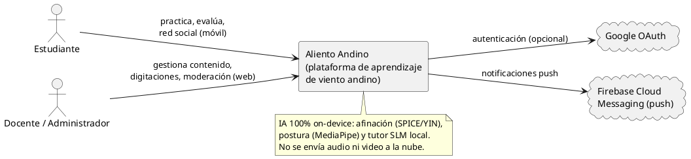
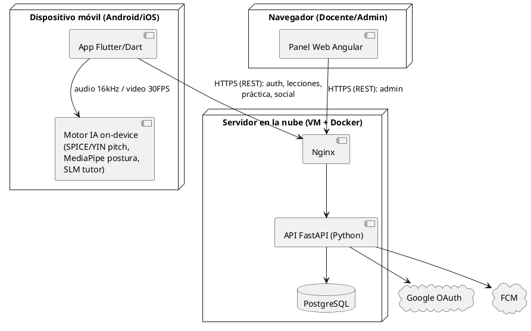
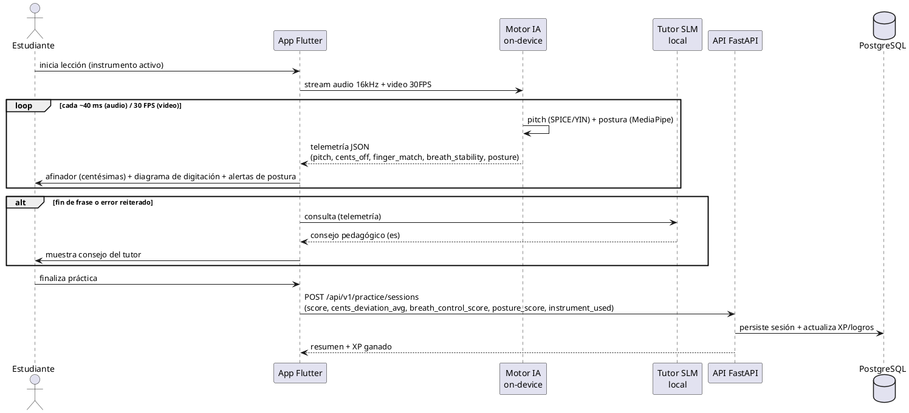

# Diagramas UML — Aliento Andino (especificación para Enterprise Architect)

> Especificación lista para dibujar/importar en **Enterprise Architect**. Cada diagrama incluye código
> **PlantUML** (lo puedes pegar en https://www.plantuml.com/plantuml o importar) y una descripción.
> El código fuente real está en `backend/app/models/`, `mobile/`, `web/`. Las marcas **(NUEVO)** y
> **(ADAPTADO)** indican cambios respecto a PianoVision para Aliento Andino.

---

## 1. Diagrama de Clases — Modelo de Datos  *(prioridad para la Épica 1)*

Refleja los modelos SQLAlchemy actuales con las adaptaciones del plan: se **eliminan** de `NoteSequence`
los campos de piano (`finger`, `hand`, `is_chord`, `chord_group`); se **añade** `FingeringChart`;
se amplían `User`, `Lesson` y `PracticeSession`.

```plantuml
@startuml ModeloDatos_AlientoAndino
hide circle
skinparam linetype ortho
skinparam classAttributeIconSize 0

class User {
  +id: UUID
  +email: String
  +username: String
  +full_name: String
  +skill_level: String
  +xp_level: int
  --(NUEVO)--
  +primary_instrument: String  ' quena|zampoña|tarka|flauta
  +secondary_instruments: JSON
  +breath_capacity_profile: JSON  ' "Soplo Suave"
  +embouchure_level: String
}

class Category {
  +id: UUID
  +name: String
  +order: int
}

class Lesson {
  +id: UUID
  +category_id: UUID
  +title: String
  +difficulty: String
  +tempo_bpm: int
  +time_signature: String
  +key_signature: String
  +genre: String  ' huayno|saya|tinku...
  --(ADAPTADO)--
  +instrument: String  ' indexado
  +breath_marks: JSON
  +articulation_patterns: JSON
}

class NoteSequence {
  +id: UUID
  +lesson_id: UUID
  +position: int
  +note: String
  +duration: float
  +is_rest: bool
  +velocity: int
  --(ADAPTADO)--
  +breath_mark: bool
  +articulation: String
  +fingering_chart_id: UUID
  ..eliminados (piano)..
  -finger  -hand  -is_chord  -chord_group
}

class FingeringChart <<NUEVO>> {
  +id: UUID
  +instrument: String
  +pitch: String
  +holes: JSON  ' abierto/cerrado/medio por orificio o tubo
  +alternate_fingerings: JSON
  +notes: String
  ..clave compuesta (instrument, pitch)..
}

class PracticeSession {
  +id: UUID
  +user_id: UUID
  +lesson_id: UUID
  +score: float
  +correct_notes: int
  +total_notes: int
  +average_tempo: float
  --(ADAPTADO)--
  +cents_deviation_avg: float
  +breath_control_score: float
  +posture_score: float
  +instrument_used: String
}

class UserXP {
  +id: UUID
  +user_id: UUID
  +total_xp: int
  +current_streak: int
}
class Achievement {
  +id: UUID
  +code: String  ' primer_soplo_limpio, maestro_siku...
  +name: String
  +description: String
}
class UserAchievement {
  +user_id: UUID
  +achievement_id: UUID
  +unlocked_at: datetime
}

class Post {
  +id: UUID
  +author_id: UUID
  +content: String
  +practice_session_id: UUID
}
class Comment { +id: UUID  +post_id: UUID  +author_id: UUID }
class Like { +user_id: UUID  +post_id: UUID }
class Follow { +follower_id: UUID  +following_id: UUID }

Category "1" --> "*" Lesson
Lesson "1" --> "*" NoteSequence
FingeringChart "1" --> "*" NoteSequence : digitación
User "1" --> "*" PracticeSession
Lesson "1" --> "*" PracticeSession
User "1" --> "1" UserXP
User "1" --> "*" UserAchievement
Achievement "1" --> "*" UserAchievement
User "1" --> "*" Post
Post "1" --> "*" Comment
User "1" --> "*" Like
Post "1" --> "*" Like
User "1" --> "*" Follow : follower
@enduml
```

**Notas para implementar (Épica 1):** crear la tabla `fingering_charts` con índice/clave compuesta
`(instrument, pitch)`; migración Alembic que elimine `finger/hand/is_chord/chord_group` y agregue
`breath_mark`, `articulation`, `fingering_chart_id` en `note_sequences`; ampliar `users`,
`lessons` y `practice_sessions`; seeder de digitaciones (escala pentatónica de Sol para Quena y Zampoña).

---

## 2. Diagrama de Contexto (C4 nivel 1)

Muestra quién usa el sistema y con qué servicios externos habla. **La IA (pitch, postura, tutor)
corre en el dispositivo**, no es un servicio externo.



---

## 3. Diagrama de Contenedores / Despliegue (C4 nivel 2)



**Clave:** el `Motor IA on-device` vive dentro de la app móvil; el backend solo persiste resultados
(telemetría/score) y sirve contenido, auth y social.

---

## 4. Diagrama de Paquetes (capas)

```plantuml
@startuml Paquetes_AlientoAndino
package "Backend (FastAPI)" {
  package "routers" {}
  package "services" {}
  package "models (SQLAlchemy)" {}
  package "schemas (Pydantic)" {}
  package "dependencies" {}
  [routers] --> [services]
  [services] --> [models]
  [routers] ..> [schemas]
  [routers] --> [dependencies]
}
package "App Móvil (Flutter)" {
  package "features\n(practice, tutor, social, profile)" as feat {}
  package "core\n(Dio, DB, GoRouter, Storage)" as core {}
  package "ml on-device\n(pitch, pose, slm)" as mlm {}
  feat --> core
  feat --> mlm
}
package "Web Admin (Angular)" {
  package "modules\n(lessons, fingerings, reports, moderation)" as wm {}
  package "services (HTTP)" as ws {}
  wm --> ws
}
[services] <.. core : REST
[services] <.. ws : REST
@enduml
```

---

## 5. Diagrama de Secuencia — Flujo de práctica con evaluación on-device



---

## Cómo usarlos en Enterprise Architect
- Puedes **previsualizar** cada diagrama pegando el bloque PlantUML en https://www.plantuml.com/plantuml
  (o con la extensión PlantUML de VS Code) y exportarlo como imagen para el documento.
- En **Enterprise Architect**: crea los diagramas (Class, Deployment, Package, Sequence) y usa este
  documento como guion de entidades, atributos y relaciones. El **modelo de datos (1)** es el que
  habilita directamente la **Épica 1** del backend.

*Siguiente paso sugerido: una vez validado el modelo de datos, empezar la Épica 1 (migración Alembic
+ modelos + seeder de digitaciones).*
