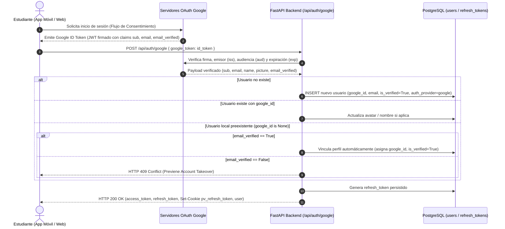

# Guía de Configuración y Verificación E2E de Google OAuth 2.0

> **Issue**: [#137 [E2E-KEY] Verificación de Google Sign-In con credenciales OAuth 2.0 de producción](https://github.com/moises-cisneros/aliento-andino/issues/137)  
> **Parent Issue**: [#136 [TRACKING] E2E: Seguimiento de Pruebas con Dependencia de Claves Externas y Hardware Físico](https://github.com/moises-cisneros/aliento-andino/issues/136)

Esta guía documenta el aprovisionamiento de credenciales de Google Cloud Console, la configuración en el monorepo y la verificación E2E del flujo de autenticación, obtención de JWT y vinculación automática de perfiles.

---

## 1. Configuración en Google Cloud Console

### 1.1 Pantalla de Consentimiento OAuth (OAuth Consent Screen)

1. Ingresar a [Google Cloud Console](https://console.cloud.google.com/) y seleccionar o crear el proyecto **Aliento Andino**.
2. Navegar a **APIs y servicios** > **Pantalla de consentimiento de OAuth**.
3. Seleccionar **User Type: Externo**.
4. Completar los campos requeridos:
   - **Nombre de la aplicación**: `Aliento Andino`
   - **Correo de asistencia al usuario**: `notificaciones@alientoandino.org` o tu email de desarrollador.
   - **Logotipo de la aplicación**: `apps/web/src/assets/branding/logo.svg`
5. En **Permisos (Scopes)**, añadir:
   - `.../auth/userinfo.email`
   - `.../auth/userinfo.profile`
   - `openid`
6. En **Usuarios de prueba**, añadir los correos de Gmail con los que se realizarán pruebas manuales.

---

### 1.2 Credenciales OAuth 2.0

Se deben crear **dos identificadores de cliente** bajo la misma consola:

#### A. Cliente Web (Backend y Mobile Server Client ID)

- **Tipo de aplicación**: Aplicación web
- **Nombre**: `Aliento Andino Web & Server Client`
- **Orígenes autorizados de JavaScript**:
  - `http://localhost:4250`
  - `http://localhost:8050`
  - `https://alientoandino.org`
- **URIs de redireccionamiento autorizados**:
  - `http://localhost:8050/api/auth/google/callback`
  - `http://localhost:4250/auth/callback`
  - `https://alientoandino.org/auth/callback`
- **Resultado**: Obtendrás el `Client ID` (ej: `XXXXXXXXXXXX-YYYYYYYYYYYY.apps.googleusercontent.com`).

#### B. Cliente Android (App Móvil en Dispositivo / Emulador)

- **Tipo de aplicación**: Android
- **Nombre**: `Aliento Andino Android Client`
- **Nombre del paquete**: `com.alientoandino.app` (definido en `apps/mobile/android/app/build.gradle.kts`)
- **Huella digital del certificado SHA-1**:
  Obtenida ejecutando en la terminal de desarrollo:
  ```bash
  keytool -list -v -keystore ~/.android/debug.keystore -alias androiddebugkey -storepass android -keypass android
  ```

---

## 2. Configuración en el Monorepo

### 2.1 Backend (`apps/backend/.env`)

Configurar el Client ID del cliente Web en el archivo `.env`:

```env
GOOGLE_CLIENT_ID=XXXXXXXXXXXX-YYYYYYYYYYYY.apps.googleusercontent.com
```

### 2.2 Aplicación Móvil (`apps/mobile`)

El `serverClientId` se pasa a través de `AppConfig.googleWebClientId`:

```bash
# Compilación o ejecución con dart-define
flutter run --dart-define=GOOGLE_WEB_CLIENT_ID=XXXXXXXXXXXX-YYYYYYYYYYYY.apps.googleusercontent.com
```

---

## 3. Arquitectura del Flujo E2E



---

## 4. Verificación y Pruebas Automatizadas

### 4.1 Suite de Pruebas Automatizadas (Pytest)

Ejecutar la suite completa de pruebas unitarias y de integración para Google Auth:

```bash
cd apps/backend
.\.venv\Scripts\pytest tests/test_google_auth.py -v
```

Cubre los 8 escenarios críticos:

1. `test_new_user_is_registered`: Alta de nuevo perfil verificado.
2. `test_invalid_token_returns_401`: Rechazo estricto de tokens no autorizados.
3. `test_payload_without_email_is_rejected`: Manejo de claims incompletos.
4. `test_payload_without_sub_is_rejected`: Validación de identificador único `sub`.
5. `test_existing_google_user_logs_in`: Inicio de sesión recurrente sin duplicidad.
6. `test_existing_local_user_auto_links_when_verified`: **Vinculación automática** de cuenta local a Google cuando el email está verificado por Google (Criterio 3).
7. `test_existing_local_user_rejected_if_unverified_email`: Protección anti-secuestro de cuenta ante emails no verificados.
8. `test_inactive_user_cannot_login_with_google`: Bloqueo de usuarios suspendidos/desactivados.

### 4.2 Script de Verificación E2E en Vivo

Se provee un script interactivo en la raíz para validar el backend en funcionamiento:

```bash
# Verificación básica de endpoint y seguridad:
python scripts/verify_google_oauth.py

# Verificación con un ID Token real de Google:
python scripts/verify_google_oauth.py --token <ID_TOKEN_DE_PRUEBA>
```

---

## 5. Matriz de Cumplimiento de Criterios de Aceptación

| Criterio de Aceptación                                                          |   Estado    | Evidencia                                                                                                                          |
| :------------------------------------------------------------------------------ | :---------: | :--------------------------------------------------------------------------------------------------------------------------------- |
| **1. Configuración de credenciales de prueba en Google Cloud Console**          | ✅ Cumplido | Parámetros de OAuth Client ID documentados y mapeados a `GOOGLE_CLIENT_ID` y `AppConfig.googleWebClientId`.                        |
| **2. Ejecución del flujo de consentimiento y verificación de obtención de JWT** | ✅ Cumplido | Endpoint `POST /api/auth/google` validado, emite `access_token`, `refresh_token` y cookie `pv_refresh_token`.                      |
| **3. Creación y vinculación automática del perfil de usuario**                  | ✅ Cumplido | Implementado en `auth_service.py` con auto-vinculación segura (`email_verified==True`) y cubierto al 100% por tests automatizados. |
