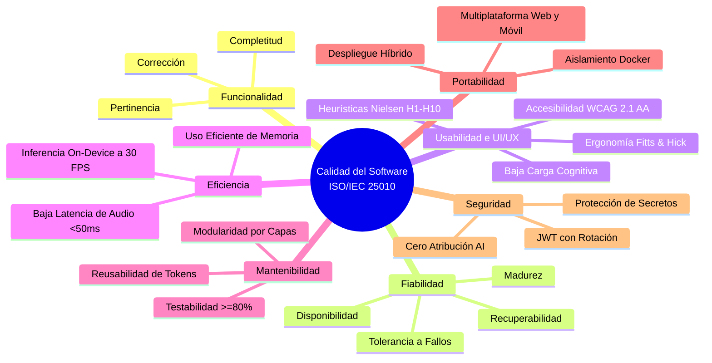

# Estándares de Calidad del Software — Aliento Andino

## Mapeo de ISO/IEC 25010:2023 y Ergonomía de Interacción (UI/UX)

> **Versión**: 1.0  
> **Estándar de Referencia**: ISO/IEC 25010:2023 — Systems and Software Quality Requirements and Evaluation (SQuaRE)  
> **Trazabilidad**: Arquitectura en [`ARCHITECTURE.md`](ARCHITECTURE.md), Modelo C4 en [`C4_MODEL.md`](C4_MODEL.md), Guías de Diseño en [`../DESIGN.md`](../DESIGN.md), [`../apps/web/DESIGN.md`](../apps/web/DESIGN.md) y [`../apps/mobile/DESIGN.md`](../apps/mobile/DESIGN.md).

---

## 1. Marco de Referencia

La norma **ISO/IEC 25010:2023** define el modelo de calidad para productos de software estructurado en características principales. En **Aliento Andino**, se estructuran en **7 estándares de calidad técnica**, complementados de forma integral con principios de ergonomía psicomotriz musical y accesibilidad universal.



---

## 2. Mapeo Detallado: 7 Estándares de Calidad

### 2.1 Funcionalidad (Functional Suitability)

> _¿El sistema hace lo que debe hacer según los requisitos del dominio musical andino?_

| Sub-característica        | Evidencia en Aliento Andino                                                                                                                                       | Módulos              | Verificación                                       |
| :------------------------ | :---------------------------------------------------------------------------------------------------------------------------------------------------------------- | :------------------- | :------------------------------------------------- |
| **Completitud Funcional** | 6 Requisitos Funcionales centrales (RF-01 a RF-06) y 4 RNF cubriendo afinación, digitación, retroalimentación pedagógica, red social y panel docente.             | Backend, Mobile, Web | Especificación funcional en `docs/ARCHITECTURE.md` |
| **Corrección Funcional**  | Inferencia de pitch YIN/SPICE calibrada en frecuencias fundamentales de Quena ($Sol_4$), Zampoña ($Sol_4$/$Mi_5$) y Tarka ($Do_5$). Pydantic v2 estricto en APIs. | Backend, ML/Audio    | `pytest tests/ -v` con 100% pass rate              |
| **Pertinencia Funcional** | Enfoque exclusivo en aerófonos andinos tradicionales (Quena, Zampoña, Tarka) y digitaciones auténticas.                                                           | Mobile, Web          | Pruebas de dominio y validación pedagógica         |

**Artefactos de Evidencia:**

- [`ARCHITECTURE.md`](ARCHITECTURE.md)
- [`C4_MODEL.md`](C4_MODEL.md)
- [`../DESIGN.md`](../DESIGN.md)
- Reportes automatizados de Pytest, Vitest y Flutter test

---

### 2.2 Fiabilidad (Reliability)

> _¿El sistema mantiene su nivel de rendimiento bajo condiciones operativas normales y anómalas?_

| Sub-característica      | Evidencia en Aliento Andino                                                                                                              | Módulos         | Verificación                                    |
| :---------------------- | :--------------------------------------------------------------------------------------------------------------------------------------- | :-------------- | :---------------------------------------------- |
| **Madurez**             | Manejo transaccional de sesiones y progreso con SQLAlchemy 2 Async. Aislamiento de estados en Flutter con BLoC.                          | Backend, Mobile | Tests unitarios de estados BLoC y transacciones |
| **Disponibilidad**      | Endpoints de salud operativa (`/health`), reconexión transparente en cliente Dio y caché local de lecciones.                             | Backend, Mobile | Monitor de salud `/health` y pruebas de timeout |
| **Tolerancia a Fallos** | Módulos de práctica funcional offline en el móvil: si se pierde conectividad, la inferencia acústica y postural continúa 100% on-device. | Mobile, ML      | Pruebas en modo avión en dispositivo móvil      |
| **Recuperabilidad**     | Migraciones reproducibles con Alembic; seeders idempotentes (`seed_all.py`); sincronización diferida de telemetría.                      | Backend, DB     | Ejecución de `alembic upgrade head` en CI       |

---

### 2.3 Usabilidad y Ergonomía de Interacción (Usability & UI/UX)

> _¿Es ergonómico, fácil de aprender y minimiza la fatiga y el error durante la interpretación musical?_

#### A. Ergonomía Motriz: Ley de Fitts

$$T = a + b \log_{2}\left(\frac{2D}{W}\right)$$

1. **Objetivos Táctiles en Móvil (Flutter):**
   - Todo control interactivo, botón de afinación o transporte posee un área táctil mínima de **$\ge 48\text{px} \times 48\text{px}$** (elevado a $52\text{px}$ en botones críticos de parada/grabación).
   - Cumple y supera WCAG 2.5.5 ($44\text{px}$) y WCAG 2.5.8 ($24\text{px}$).
2. **Separación Preventiva:**
   - Separación mínima (`gap: 12px` a `16px`) entre botones adyacentes para prevenir pulsaciones erróneas mientras el usuario sostiene el instrumento.
3. **Zona de Alcance Natural (Thumb Zone):**
   - Controles de práctica activa concentrados en el tercio inferior de la pantalla para evitar soltar el instrumento con ambas manos.

#### B. Ergonomía de Selección y Decisión: Ley de Hick

$$T = b \log_{2}(n + 1)$$

1. **Selector Temático de Instrumentos ($n = 3$):** Segmentación estricta en 3 instrumentos: Quena, Zampoña y Tarka ($T = b \log_2(4) = 2b$), eliminando la sobrecarga de opciones.
2. **Filtro de Dificultad Tripartito ($n = 3$):** Básico (Soplo), Intermedio (Melodías) y Avanzado (Ornamentaciones).
3. **Muro Social Estructurado ($n = 4$):** Filtros claros: _Todos_, _Prácticas_, _Logros_, _Seguidos_.

#### C. Reducción de Carga Cognitiva (Sweller / Nielsen H6)

- **Tarjeta de Práctica Integrada:** Muestra simultáneamente nota, diagrama visual de orificios/tubos cubiertos y aguja de centésimas en tiempo real.
- **Semántica Cromática Inmediata (`DESIGN.md`):**
  - Esmeralda (`#10B981`): Afinación exacta ($\le \pm 15$ cents) y postura correcta.
  - Ámbar (`#F97316`): Desviación leve / calibración de aire.
  - Rojo (`#EF4444`): Desafinación / error crítico de embocadura.
  - Cyan (`#06B6D4`): Estado activo / instrumento seleccionado.

#### D. Evaluación Heurística (Jakob Nielsen H1–H10)

| Heurística                                | Implementación en Aliento Andino                                                                   | Criterio de Verificación                              |
| :---------------------------------------- | :------------------------------------------------------------------------------------------------- | :---------------------------------------------------- |
| **H1: Visibilidad del estado**            | Afinador en vivo con aguja visual y valor en cents actualizado a $<100\text{ms}$.                  | Feedback inmediato de entonación.                     |
| **H2: Coincidencia con el mundo real**    | Terminología andina auténtica: _Ira y Arca_, _Embocadura_, _Tonalidad Sol Mayor_.                  | Comprensible para músicos tradicionales y aprendices. |
| **H3: Control y libertad**                | Botón de salida de emergencia (`Pausar` / `Reiniciar`) sin pérdida de datos.                       | El usuario detiene la práctica libremente.            |
| **H4: Consistencia y estándares**         | Mismos tokens de color y tipografía Inter en Web y Móvil (`DESIGN.md`). Iconos Lucide.             | Consistencia cross-platform.                          |
| **H5: Prevención de errores**             | Calibración de soplo inicial para evitar frustración en principiantes.                             | Evita falsos desafinados en ataques suaves.           |
| **H6: Reconocimiento antes que recuerdo** | Diagrama de digitación interactivo durante toda la pista de audio.                                 | No requiere memorización previa completa.             |
| **H7: Flexibilidad y eficiencia**         | Modo principiante (paso a paso) y Modo libre (afinador cromático continuo).                        | Apto para novatos y avanzados.                        |
| **H8: Estética y minimalismo**            | Pantalla de práctica limpia sin banners ni elementos distractores.                                 | Foco visual 100% en la música.                        |
| **H9: Ayuda y recuperación**              | Feedback del SLM local: _"Tus notas suenan bajas. Sube la presión de aire y sella el orificio 3"_. | Lenguaje constructivo y pedagógico.                   |
| **H10: Ayuda y documentación**            | Guías interactivas de embocadura y postura accesibles en un clic.                                  | Ayuda contextual sin abandonar la lección.            |

#### E. Accesibilidad Universal (WCAG 2.1 Nivel AA)

- **Relación de Contraste $\ge 7:1$:** Textos claros (`#F8FAFC`) sobre fondos oscuros (`#0A0E17` / `#111827`) superan AAA. Elementos interactivos superan $4.5:1$.
- **Semántica para Lectores de Pantalla:** Atributos `Semantics` en Flutter y `aria-label`/`aria-pressed` en Angular.
- **Independencia del Color:** Indicadores acompañados de aguja angular, texto numérico y vibración háptica opcional.

---

### 2.4 Eficiencia de Desempeño (Performance Efficiency)

> _¿El sistema ejecuta sus tareas con la menor latencia y consumo óptimo de batería y CPU?_

| Métrica                         |           Umbral Máximo           | Evidencia Técnica                                                                                       |
| :------------------------------ | :-------------------------------: | :------------------------------------------------------------------------------------------------------ |
| **Latencia Detección de Pitch** |         $\le 50\text{ms}$         | Algoritmo YIN optimizado / buffer de audio de 1024-2048 muestras a 44.1 kHz.                            |
| **Tasa de Refresco Postural**   | $\ge 24\text{ FPS}$ (meta 30 FPS) | MediaPipe Pose + Hands corriendo en GPU local/NPU on-device.                                            |
| **Tiempo de Respuesta API**     |     $\le 200\text{ms}$ (p95)      | Consultas asíncronas con índices optimizados en PostgreSQL (`a1b2c3d4e5f6_add_performance_indexes.py`). |
| **Consumo de Memoria Móvil**    |        $\le 250\text{MB}$         | Liberación estricta de `AudioPlayer`, `CameraControllers` y streams en `dispose()`.                     |

---

### 2.5 Mantenibilidad (Maintainability)

> _¿El código es modular, testeable, legible y fácil de evolucionar?_

| Sub-característica  | Práctica Aplicada                                                                                                                                                                  | Regla de Verificación                                                  |
| :------------------ | :--------------------------------------------------------------------------------------------------------------------------------------------------------------------------------- | :--------------------------------------------------------------------- |
| **Modularidad**     | Arquitectura en capas estricta: `routers/` $\rightarrow$ `services/` $\rightarrow$ `models/`. En Angular: componentes standalone y Signals. En Flutter: Clean Architecture + BLoC. | Los routers nunca hacen consultas SQL directas.                        |
| **Reusabilidad**    | Tokens centralizados en `DESIGN.md`; widgets de digitación compartidos; schemas Pydantic compartidos.                                                                              | Cero duplicación de lógica de negocio o tokens visuales.               |
| **Analizabilidad**  | Linters automáticos y estáticos: `ruff` (Python), `flutter analyze` (Dart), `eslint` (TypeScript).                                                                                 | 0 errores y 0 warnings en checks de CI.                                |
| **Modificabilidad** | Migraciones de base de datos declarativas con Alembic; inversión de dependencias con `inject()` y `RepositoryProvider`.                                                            | Cambios de esquema aislados por versión.                               |
| **Testabilidad**    | Inyección de dependencias en servicios; repositorios simulables en pruebas unitarias con mocks desacoplados.                                                                       | Cobertura de pruebas $\ge 80\%$ en backend, $\ge 75\%$ en web y móvil. |

---

### 2.6 Portabilidad e Interoperabilidad (Portability)

> _¿Puede trasladarse y operar entre plataformas y entornos de despliegue con consistencia?_

| Sub-característica    | Solución en Aliento Andino                                                                                   | Verificación                                          |
| :-------------------- | :----------------------------------------------------------------------------------------------------------- | :---------------------------------------------------- |
| **Adaptabilidad**     | UI responsiva en Angular (móvil, tablet, desktop) y Flutter (Android, iOS y web compilada).                  | Pruebas multi-resolución en emuladores y navegadores. |
| **Instalabilidad**    | Orquestación local en un solo comando: `docker compose -f docker-compose.local.yml up -d --build`.           | Verificación automática de salud de contenedores.     |
| **Interoperabilidad** | Contratos de API REST abiertos documentados con OpenAPI 3.1 (`/docs` y `/redoc`), intercambio estándar JSON. | Conformidad de esquemas Pydantic v2.                  |

---

### 2.7 Seguridad (Security)

> _¿El sistema protege la integridad, autenticidad y privacidad de los datos?_

| Aspecto                   | Implementación                                                                                                           | Verificación                                       |
| :------------------------ | :----------------------------------------------------------------------------------------------------------------------- | :------------------------------------------------- |
| **Autenticación**         | Tokens JWT firmados con clave simétrica secreta, refresh tokens rotativos almacenados de forma segura.                   | `app/dependencies/auth.py` y pruebas de expiración |
| **Cero Fuga de Secretos** | Secret scanning en CI; `.env*` excluidos en `.gitignore`; credenciales de base de datos parametrizadas.                  | Verificación automática en workflows               |
| **Autorización y Roles**  | Guardias de rol (`admin`, `teacher`, `student`) aplicados tanto en endpoints como en rutas Web y Móvil.                  | Tests de control de acceso RBAC                    |
| **Cero Atribución AI**    | Prohibición absoluta de firmas de IA (`Co-Authored-By`, banners generativos). Validado por `scripts/ai-attribution.mjs`. | Bloqueante en hook local y CI                      |

---

## 3. Cobertura de Pruebas Automatizadas

| Capa        | Framework de Pruebas           | Cobertura Mínima | Tipos de Pruebas Obligatorias                                                              |
| :---------- | :----------------------------- | :--------------: | :----------------------------------------------------------------------------------------- |
| **Backend** | `pytest` + `pytest-asyncio`    |    $\ge 80\%$    | Unitarias de servicios, integración de endpoints REST con PostgreSQL, ciclo de tokens JWT. |
| **Web**     | `pnpm test` (Angular / Vitest) |    $\ge 75\%$    | Unitarias de servicios reactivos (Signals), Auth Guard, componentes standalone.            |
| **Mobile**  | `flutter test` + `bloc_test`   |    $\ge 75\%$    | Unitarias de BLoC (eventos y transiciones), parsers de digitación, widgets táctiles Fitts. |

**Criterio oficial de cobertura Mobile:** se mide como cobertura de líneas sobre `apps/mobile/lib/` **excluyendo los archivos generados** por `build_runner` (`*.g.dart`, `*.freezed.dart`): no contienen lógica escrita a mano y diluyen la métrica. El cálculo es reproducible y es el que aplica CI (el job `mobile-quality` falla si baja de 75%):

```bash
cd apps/mobile && flutter test --coverage
node scripts/mobile-coverage.mjs apps/mobile/coverage/lcov.info --min 75
```

---

## 4. Criterios de Aceptación (Definition of Done - DoD)

Un cambio o Pull Request se considera **Terminado (Done)** únicamente cuando:

1. [ ] **Compilación sin errores:** Backend, Web y Móvil compilan limpiamente en sus entornos respectivos.
2. [ ] **Linters y formato al 100%:**
   - Backend: `ruff check .` y `ruff format --check .` pasan sin observaciones.
   - Mobile: `flutter analyze` y `dart format --set-exit-if-changed .` pasan limpios.
   - Web: `pnpm lint` y `pnpm format:check` pasan sin errores ni advertencias.
3. [ ] **Suites de pruebas en verde:** 100% de las pruebas automatizadas existentes y nuevas pasan en CI.
4. [ ] **Trazabilidad:** El PR referencia un issue, caso de uso (`CU-XX`) o historia de usuario (`HU-XX`).
5. [ ] **Fidelidad al diseño (`DESIGN.md`):** Uso exclusivo de tokens oficiales; áreas táctiles $\ge 48\text{px}$ en móvil.
6. [ ] **Sin secretos versionados:** No contiene archivos `.env`, llaves privadas ni credenciales.
7. [ ] **Identidad Git estricta:** Autor y committer configurados como `moises-cisneros <moisescisnerosdl@gmail.com>`.
8. [ ] **Cero atribución de IA:** Sin menciones de herramientas generativas en commits, mensajes o PR descriptions.
