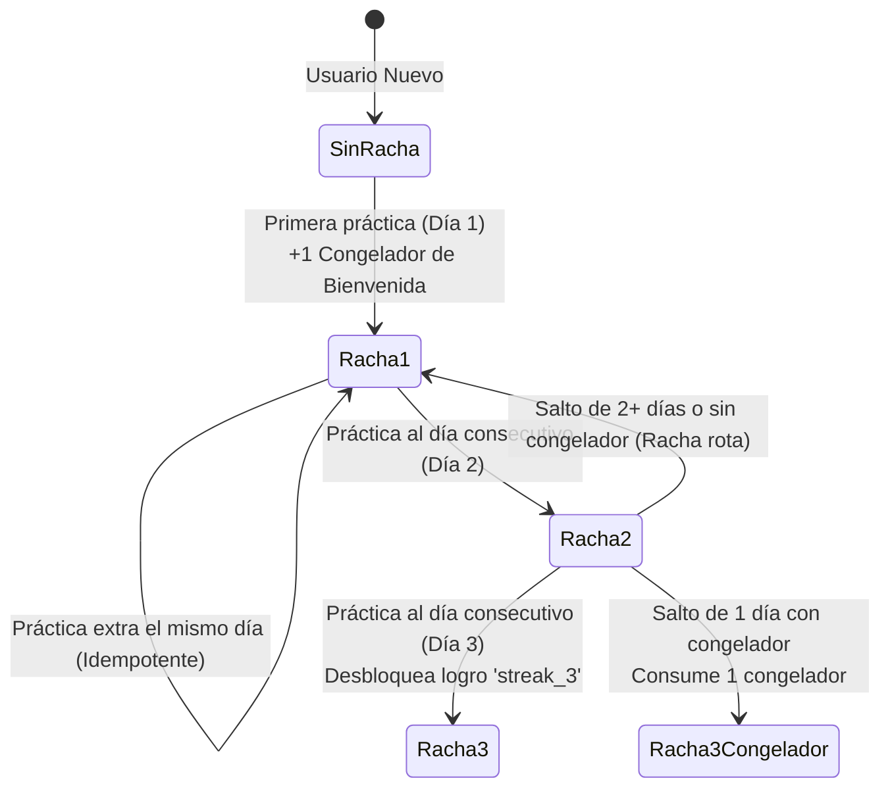

# Verificación de Racha de 3 Días y Transiciones de Calendario

> **Issue**: [#141 [E2E-HW] Verificación de racha de 3 días con reloj de sistema y transiciones de calendario](https://github.com/moises-cisneros/aliento-andino/issues/141)  
> **Parent Issue**: [#136 [TRACKING] E2E: Seguimiento de Pruebas con Dependencia de Claves Externas y Hardware Físico](https://github.com/moises-cisneros/aliento-andino/issues/136)  
> **Historia de Usuario**: **HU-13** (Gamificación: Rachas, Logros y Niveles de XP)  
> **Área**: `area:backend`, `area:mobile` | **Sprint**: 3

---

## 1. Arquitectura de Cómputo de Racha Diaria

El motor de gamificación calcula la racha del estudiante evaluando **días calendario consecutivos en UTC** a través de `ranking_service.update_user_streak()`:

### Máquina de Estados de Racha Diaria



---

## 2. Criterios de Aceptación Verificados

| Criterio       | Momento de Práctica            | Racha Resultante     | Efectos Colaterales                                                                                                                      |
| :------------- | :----------------------------- | :------------------- | :--------------------------------------------------------------------------------------------------------------------------------------- |
| **Criterio 1** | **Día 1** ($T_0$)              | `current_streak = 1` | Se inicializa la racha y se otorga el congelador de bienvenida (`streak_freezes = 1`). Múltiples prácticas el Día 1 no alteran la racha. |
| **Criterio 2** | **Día 2** ($T_0 + 24\text{h}$) | `current_streak = 2` | Transición de calendario detectada: `last == practice_day - 1`.                                                                          |
| **Criterio 3** | **Día 3** ($T_0 + 48\text{h}$) | `current_streak = 3` | Racha = 3. `check_achievements()` desbloquea el logro `streak_3` ("En Racha", +30 XP) y notifica al usuario.                             |

---

## 3. Catálogo de Logro de Racha

En `seed_achievements.py`:

```json
{
  "code": "streak_3",
  "name": "En Racha",
  "description": "Practicá 3 días seguidos",
  "icon": "local_fire_department",
  "category": "streak",
  "xp_reward": 30,
  "requirement_type": "streak",
  "requirement_value": 3,
  "rarity": "common"
}
```

---

## 4. Contratos de API Actualizados

El endpoint `POST /api/practice/submit` ahora retorna directamente `current_streak` en su respuesta para actualización reactiva en Flutter y Angular:

```json
{
  "session": {
    "id": "7f8b9a10-...",
    "score": 95.0,
    "completed": true
  },
  "xp_earned": 50,
  "new_level": false,
  "current_level": 2,
  "current_streak": 3,
  "new_achievements": [
    {
      "code": "streak_3",
      "name": "En Racha",
      "xp_reward": 30
    }
  ]
}
```

---

## 5. Instrucciones de Verificación

### Ejecución de Pruebas Unitarias y de Integración E2E

```bash
cd apps/backend
.\.venv\Scripts\pytest tests/test_streak_transition_e2e.py -v
```

### Ejecución del Script de Verificación CLI

```bash
python scripts/verify_streak_transitions.py
```
